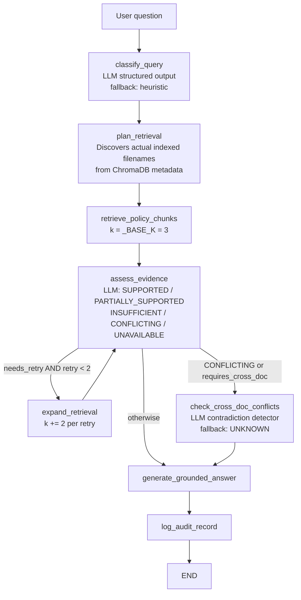
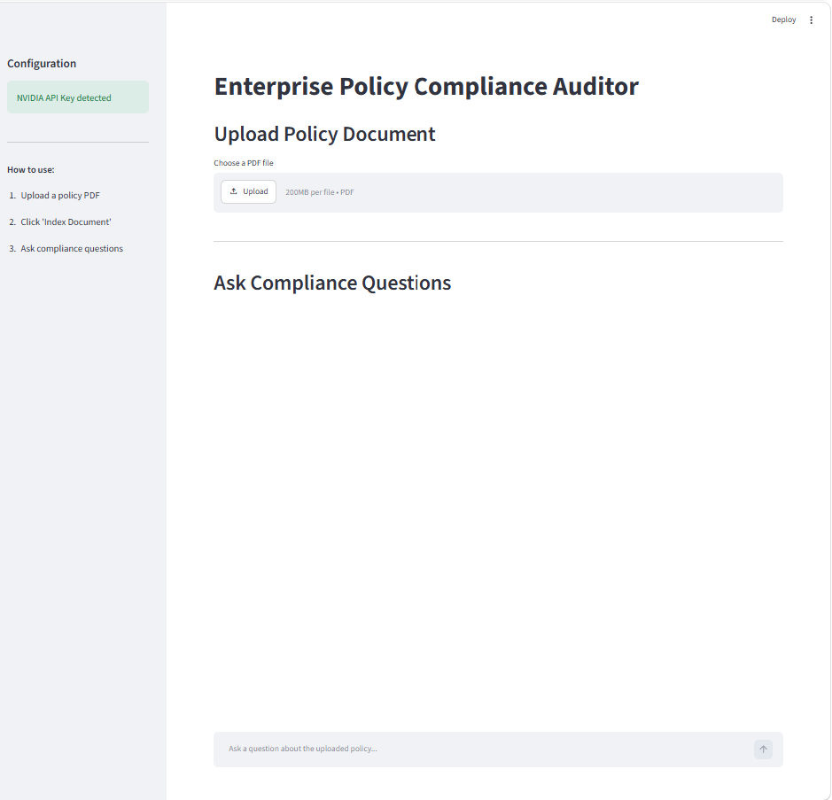
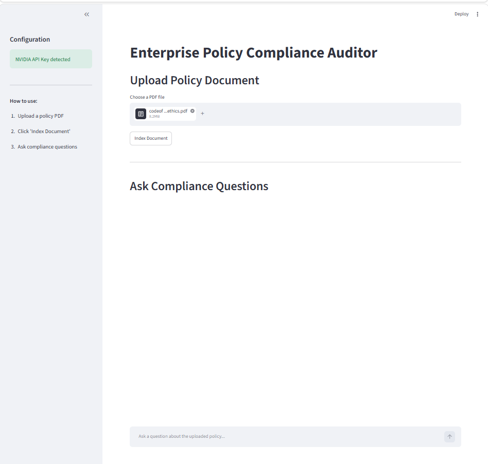
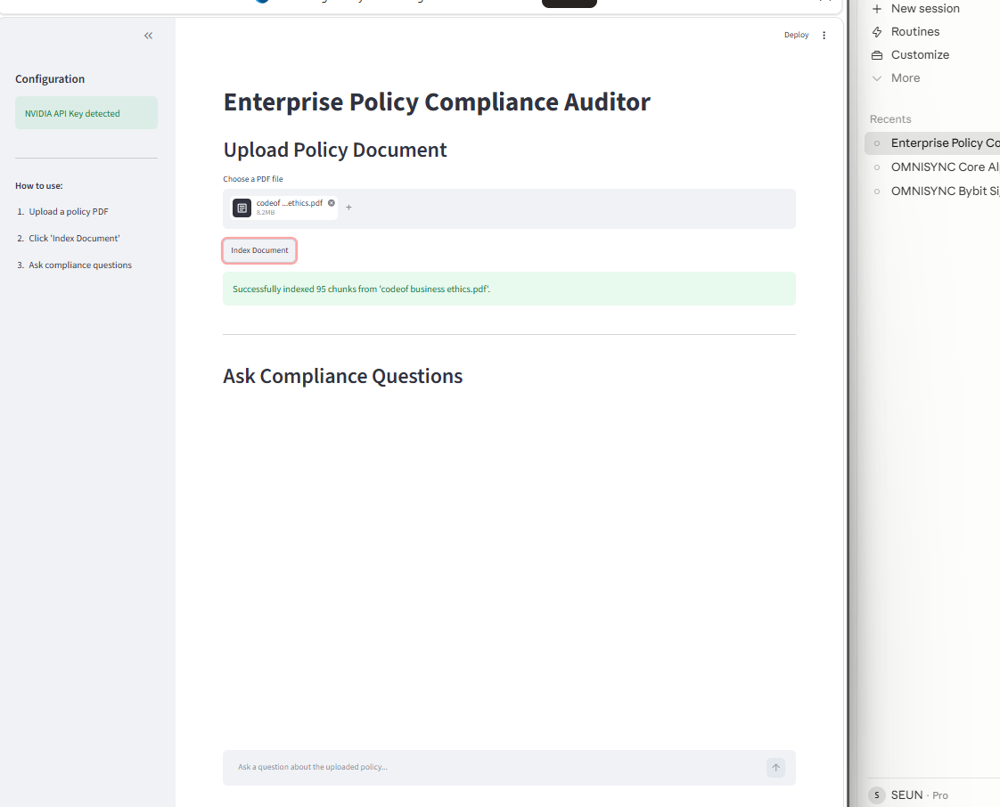
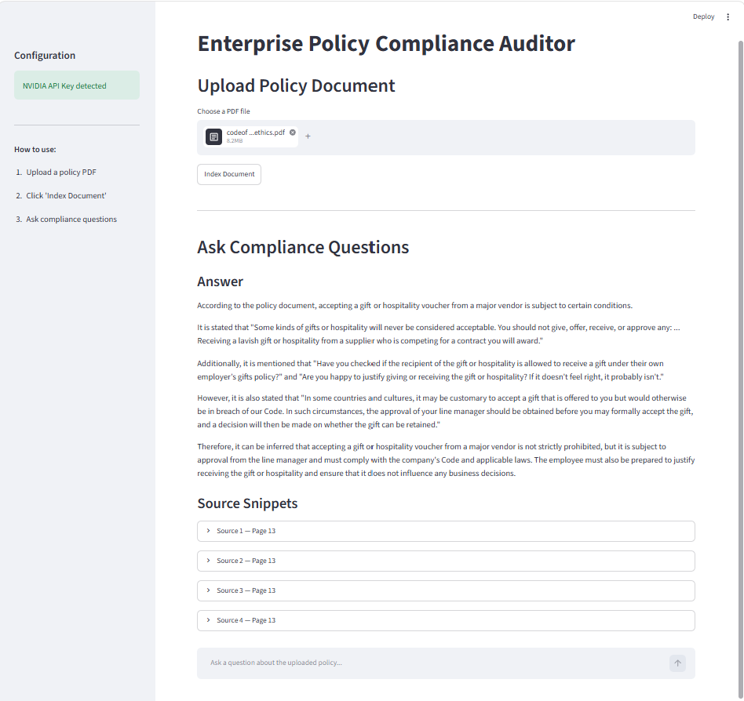
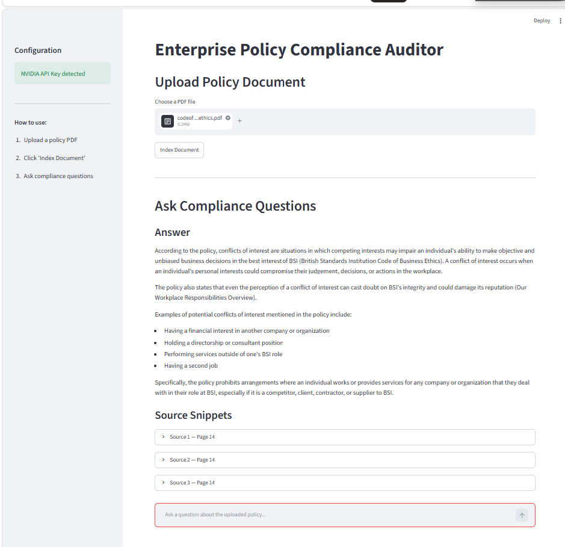
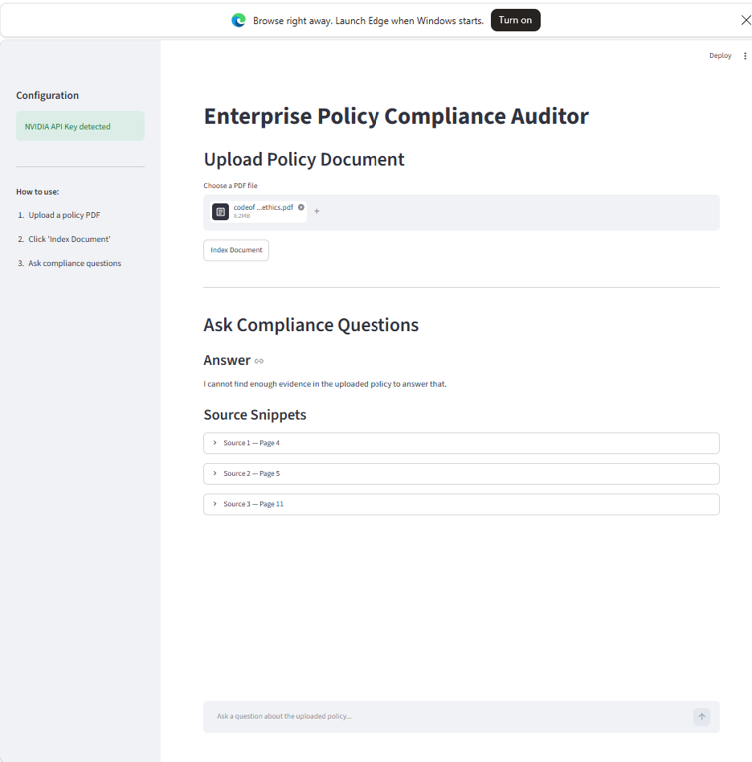

# Enterprise Policy Compliance Auditor

A Streamlit application that lets compliance teams upload corporate policy PDFs and ask natural-language questions across them. Answers are grounded strictly in the uploaded documents with source citations showing filename and page number. Two analysis modes are available: a fast Standard RAG pipeline and a multi-step Agentic Compliance Analysis pipeline built on LangGraph.

> **Important — human review required.** This tool surfaces relevant policy text and assists with research. It does not replace qualified legal, HR or compliance advice. All material compliance decisions must be reviewed by a human professional.

---

## Contents

1. [Business Problem](#business-problem)
2. [Solution and Architecture](#solution-and-architecture)
3. [Phase 4 — Agentic RAG Pipeline](#phase-4--agentic-rag-pipeline)
4. [Tech Stack](#tech-stack)
5. [Installation](#installation)
6. [Configuration](#configuration)
7. [Running the Application](#running-the-application)
8. [Testing](#testing)
9. [Evaluation Results](#evaluation-results)
10. [Screenshots](#screenshots)
11. [Snowflake Audit Logging](#snowflake-audit-logging)
12. [Security Considerations](#security-considerations)
13. [Known Limitations](#known-limitations)
14. [Future Improvements](#future-improvements)

---

## Business Problem

Compliance teams, HR and operations staff regularly need to search lengthy policy documents for specific answers. Manual review is slow, inconsistent and creates risk when clauses are missed or misinterpreted. This application provides a faster, auditable way to query uploaded policy documents without exposing production data or requiring a live internet connection for retrieval.

---

## Solution and Architecture

### Standard RAG pipeline

```
User question
     │
     ▼
ChromaDB similarity search (k=3 chunks)
     │
     ▼
Build context string (whole chunks, max 8 000 chars)
     │
     ▼
NVIDIA NIM — meta/llama-3.1-70b-instruct
     │
     ▼
Grounded answer + source citations
     │
     ▼
Optional: Snowflake audit log
```

### Agentic RAG pipeline (Phase 4)



The eight LangGraph nodes each fall back gracefully when the NVIDIA LLM is unavailable:

| Node | On LLM failure |
|---|---|
| `classify_query` | Heuristic keyword classification |
| `plan_retrieval` | Uses all available indexed sources |
| `assess_evidence` | Keyword-overlap heuristic; status = UNAVAILABLE |
| `check_cross_doc_conflicts` | Returns UNKNOWN (safety-first, not NO_CONFLICT) |
| `generate_grounded_answer` | Returns `answer_type="error"` |

Answer types returned by the pipeline:

| `answer_type` | Meaning |
|---|---|
| `grounded` | LLM confirmed SUPPORTED evidence, answer generated |
| `partial_grounded` | PARTIALLY_SUPPORTED; caveat appended |
| `unverified_grounded` | Evidence LLM unavailable but heuristic says sufficient |
| `excerpt_fallback` | All LLM citations fabricated; raw excerpts returned |
| `refusal` | Insufficient evidence; "I cannot find enough evidence…" |
| `error` | LLM call failed; safe error message returned |

Safety gates in `generate_grounded_answer`:
1. No docs retrieved → `refusal`
2. LLM evidence `not sufficient` and status not UNAVAILABLE/PARTIAL → `refusal`
3. PARTIAL evidence, coverage < 0.3 after retries exhausted → `refusal`
4. UNAVAILABLE evidence and heuristic `sufficient=False` → `refusal` (Stage 4d fix)
5. All LLM-generated citations fabricated → `excerpt_fallback`

---

## Phase 4 — Agentic RAG Pipeline

Phase 4 adds the LangGraph agentic pipeline alongside the existing Standard RAG path. Key capabilities added across Stage 4a–4d:

- **LangGraph StateGraph** with eight typed nodes and conditional routing
- **LLM-based query classification** (no hard-coded topic keyword lists)
- **Versioned ChromaDB indexing** with atomic slot-swap and rollback protection
- **Evidence quality assessment** with structured Pydantic output
- **Retrieval expansion** — up to two retries with k increasing by 2 per retry
- **Cross-document conflict detection** — genuine contradiction flagging
- **Citation validation** — fabricated `[filename.pdf, Page N]` citations stripped
- **Audit metadata** — every agent run records classification, evidence status, retry count and conflict status

---

## Tech Stack

| Component | Technology |
|---|---|
| Language | Python 3.11 |
| Frontend | Streamlit 1.58 |
| Agent orchestration | LangGraph 1.2.18 |
| LLM orchestration | LangChain 1.3.10 |
| Vector database | ChromaDB 1.5.9 |
| Embeddings | sentence-transformers/all-MiniLM-L6-v2 |
| LLM | NVIDIA NIM — meta/llama-3.1-70b-instruct |
| PDF parsing | PyPDF 6.13.3 |
| Audit logging (optional) | Snowflake |
| Environment | python-dotenv |

---

## Installation

**Supported runtime: Python 3.11.** Python 3.13 is not supported (chromadb 1.5.9 has an opentelemetry incompatibility on 3.13).

```powershell
# Windows PowerShell — create an isolated Python 3.11 environment
py -3.11 -m venv venv311
venv311\Scripts\activate
python -m pip install --upgrade pip
pip install -r requirements.txt
```

On Linux/macOS:

```bash
python3.11 -m venv venv311
source venv311/bin/activate
pip install --upgrade pip
pip install -r requirements.txt
```

---

## Configuration

Copy the example environment file and add your credentials:

```powershell
copy .env.example .env   # Windows
# cp .env.example .env   # Linux/macOS
```

Open `.env` and set:

```
NVIDIA_API_KEY=your_nvidia_api_key_here
```

Snowflake variables are optional — the app runs fully without them:

```
SNOWFLAKE_ACCOUNT=your_account_identifier
SNOWFLAKE_USER=your_snowflake_username
SNOWFLAKE_PASSWORD=your_snowflake_password
SNOWFLAKE_WAREHOUSE=your_warehouse_name
SNOWFLAKE_DATABASE=your_database_name
SNOWFLAKE_SCHEMA=your_schema_name
SNOWFLAKE_ROLE=your_role_name
```

Obtain a free NVIDIA API key at [build.nvidia.com](https://build.nvidia.com).

**Never commit `.env` to Git.** It is listed in `.gitignore`. Only `.env.example` (with placeholder values) is safe to commit.

---

## Running the Application

```powershell
venv311\Scripts\python.exe -m streamlit run app.py
```

The app opens in your browser at `http://localhost:8501`.

**How to use:**
1. Upload one or more policy PDFs using the file uploader.
2. Click **Index Documents** — text is extracted, chunked and stored in ChromaDB.
3. Choose **Standard RAG** (fast) or **Agentic Compliance Analysis** (thorough).
4. Type a question in the chat input.

---

## Testing

The full offline test suite requires Python 3.11 and covers 480 tests across nine test files.

```powershell
# Install test runner
pip install pytest pytest-timeout

# Run the complete suite (includes ChromaDB integration tests)
venv311\Scripts\python.exe -m pytest tests/ --timeout=300 -v

# Generate fixture PDFs first (one-time, or after clean checkout)
venv311\Scripts\python.exe tests/fixtures/make_fixtures.py
```

Test coverage:

| File | What it covers |
|---|---|
| `test_indexing.py` | ChromaDB index creation, versioned switching, repeated indexing, rollback, document retrieval, legacy index compatibility |
| `test_rag_pipeline.py` | `ask_question()` contract, mocked LLM responses, unsupported-question refusal, page-number grounding |
| `test_rag_evaluation.py` | Retrieval hit rate, key-term coverage, cross-document completeness using fixture PDFs |
| `test_agent_graph.py` | LangGraph node unit tests with mocked LLM |
| `test_agent_4b.py` | Agent retrieval equivalence vs Standard RAG baseline |
| `test_comparative_4d.py` | Stage 4d regression: safety gate, refusal accuracy, difficult scenarios |
| `test_apptest_4c.py` | Streamlit AppTest acceptance tests |
| `test_streamlit_4c.py` | Additional Streamlit integration checks |
| `test_snowflake_logger.py` | Snowflake logger with mocked connector |

All tests are **offline** — no live NVIDIA or Snowflake calls are made.

---

## Evaluation Results

The `evaluation/evaluate_4d.py` script runs a 38-question fictional-policy benchmark using three fixture PDFs (IT Security, HR Leave, Finance Expense policies). All LLM calls are mocked; answer text accuracy is **not** measured offline.

```powershell
venv311\Scripts\python.exe evaluation/evaluate_4d.py
```

### Stage 4d results (mocked LLM, Python 3.11, offline)

| Metric | Standard RAG | Agentic RAG |
|---|---|---|
| Source-document hit rate | **100%** | **100%** |
| Key-term coverage | **100%** | **100%** |
| Cross-document complete rate | **100%** | **100%** |
| Refusal accuracy (unsupported questions) | n/a¹ | **100%** |
| Citation validation pass rate | n/a | **100%** |
| Difficult scenarios passed | n/a | **6 / 6** |

¹ Standard RAG refusal depends on the live LLM following its system prompt — not measurable offline.

**What is and is not measured:**
- ✅ Retrieval hit rate (does the right document chunk appear in the top-k results?)
- ✅ Key-term coverage (do retrieved chunks contain expected policy terminology?)
- ✅ Mocked refusal accuracy (does the safety gate refuse unsupported questions with a mock LLM?)
- ✅ Citation fabrication detection (does the validator strip invented `[filename, page]` references?)
- ❌ Answer factual correctness — requires live NVIDIA API inference (not included to avoid paid calls)

---

## Screenshots

### 1. App Homepage


### 2. PDF Uploaded and Ready to Index


### 3. PDF Indexed Successfully


### 4. Gifts and Hospitality Answer with Source Snippets


### 5. Conflicts of Interest Answer


### 6. Hallucination Control / Refusal Test


---

## Demo Video

[Watch the demo video](demo/enterprise_policy_compliance_demo.mp4)

---

## Snowflake Audit Logging

When Snowflake credentials are present in `.env`, each query is logged to `RAG_COMPLIANCE_DB.AUDIT_LOGS.RAG_QUERY_LOGS` with:

- User question and AI answer
- Source filenames and page numbers
- Evidence-found status
- Model name and response time
- Unique log ID and timestamp

If credentials are absent or the connection fails, the app continues normally with logging disabled. Logging failures are isolated — they never prevent an answer from being returned to the user.

---

## Security Considerations

- **NVIDIA API key** — read from environment variable only; never logged or displayed.
- **Snowflake password** — read from environment variable; connection errors are caught and returned as safe messages without exposing credential values.
- **Policy document content** — stored in ChromaDB locally; answer excerpts are logged to Snowflake when configured (intentional audit feature). Never sent to external services beyond the NVIDIA NIM API endpoint.
- **Citation fabrication** — the agentic pipeline validates every `[filename.pdf, Page N]` citation against the actual retrieved chunks and strips invented references.
- **Retrieval bounds** — at most 3 LLM retrieval cycles (1 initial + 2 retries); bounded by `_MAX_RETRIES = 2`.
- **ChromaDB concurrency** — single-writer design documented in `database.py`; atomic slot-swap prevents partial reads.

---

## Known Limitations

- **Python 3.11 required** — chromadb 1.5.9 has an opentelemetry incompatibility on Python 3.13.
- **PDF documents only** — DOCX and other formats are not supported.
- **Single-writer indexing** — concurrent `index_documents()` calls may race; safe for Streamlit's single-threaded reruns but requires a file-lock for multi-worker deployments.
- **Answer correctness not measured offline** — retrieval quality is validated; whether the LLM constructs a correct sentence from that context requires live inference.
- **ChromaDB is local** — no cloud persistence; suitable for local and single-server deployment.
- **Re-indexing replaces the previous store** — incremental document addition is not yet supported.
- **Portfolio MVP** — not a replacement for legal, HR or compliance advice.

---

## Future Improvements

- Incremental document indexing without full rebuild.
- Downloadable compliance report generation.
- Multi-worker file-lock for concurrent indexing.
- User authentication for team-based access.
- Streamlit Cloud deployment with secure secret management.
- DOCX file upload support.
- Confidence scoring and calibrated evidence strength display.
- Live LLM accuracy benchmarking against a reference answer set.

---

## CI/CD

GitHub Actions runs the full offline test suite on every push to `main` and `feature/agentic-rag-v4` and on every pull request targeting `main`. The workflow:

- Uses Python 3.11
- Installs pinned dependencies from `requirements.txt`
- Runs `py_compile` on all application and agent modules
- Generates fixture PDFs
- Runs the complete `pytest tests/` suite including ChromaDB integration tests
- Sets all API key environment variables to empty strings — no paid calls are made
- Caches pip dependencies for faster runs
- Uploads pytest output as an artifact on failure
